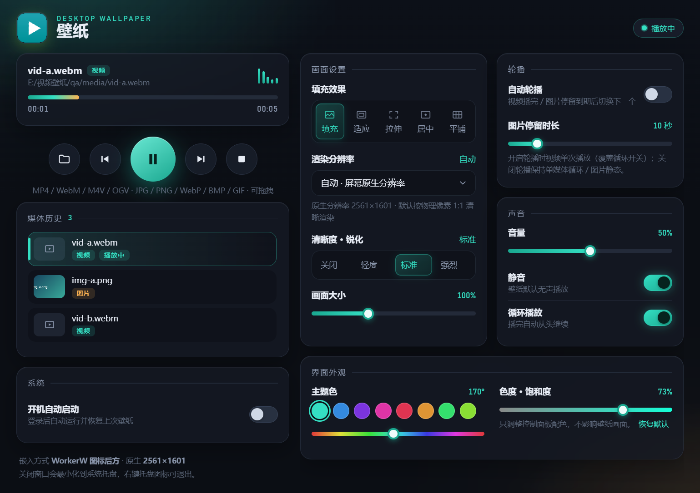

# 壁纸 · Desktop Wallpaper

在 Windows 桌面图标**后方**播放视频 / 图片的壁纸软件。基于 Electron，通过 WorkerW 嵌入把壁纸窗口挂到桌面壁纸层，图标与任务栏不受影响。支持媒体历史与可控轮播。



## 功能特性

- **大矩形双栏面板**：左侧播放控制与媒体历史，右侧画面 / 轮播 / 声音 / 系统 / 外观卡片网格，一屏总览。
- **原生分辨率清晰渲染**：默认按屏幕物理像素 1:1 渲染（如 2560×1600），不经过 CSS 放大，画面锐利。
- **视频 + 图片壁纸**：视频 MP4 / WebM / M4V / OGV；图片 JPG / PNG / WebP / BMP / GIF，均按现有填充 / 分辨率 / 锐化 / 缩放设置渲染。
- **媒体历史列表**：记录添加过的所有视频与图片（持久化），缩略图 / 文件名 + 类型标识 + 当前播放高亮；点击即切换；单条删除可撤销；文件被移动 / 删除的条目标记失效并在轮播时跳过。
- **可控轮播**：明显的「自动轮播」开关（默认关）。开启后视频播完（单次）或图片停留到期自动切换下一个、末尾回绕；图片停留时长可调（默认 10 秒）。关闭时保持单视频循环 / 图片静态。另有上一个 / 下一个手动按钮，轮播中点击历史项或手动按钮可正确接管。
- **五种填充效果**：填充（cover）、适应（contain）、拉伸（fill）、居中（center）、平铺（tile）。
- **渲染分辨率可调**：自动（屏幕原生）或 25%–200% 手动缩放，低配机器可降档省资源。
- **清晰度·锐化**：关闭 / 轻度 / 标准 / 强烈 四档 SVG 卷积锐化。
- **画面大小**：50%–200% 壁纸层缩放。
- **界面外观**：8 个主题色预设 + 色相（0–360°）/ 色度（0–100%）滑杆，实时换肤并持久化，只影响控制面板。
- **开始 / 停止可反复切换**：停止后隐藏壁纸层，**桌面恢复原壁纸**，不留黑屏；再次开始即恢复播放。
- **设置持久化**：所有选项与上次视频保存在 `%APPDATA%/video-wallpaper`，重启自动恢复。
- **托盘与开机自启**：关闭窗口最小化到托盘，右键托盘退出；可选开机自启。
- **声音控制**：音量滑杆、静音、循环开关。
- **便携分发**：单目录解压即用，无需安装。

## 画面设置说明

| 选项 | 取值 | 说明 |
| --- | --- | --- |
| 填充效果 | 填充 / 适应 / 拉伸 / 居中 / 平铺 | 视频与屏幕的适配方式；平铺用 canvas 重复绘制 |
| 渲染分辨率 | 自动 / 25%–200% | 自动 = 屏幕原生分辨率；手动档通过设备 emulation 改变光栅像素密度 |
| 清晰度·锐化 | 关闭 / 轻度 / 标准 / 强烈 | `feConvolveMatrix` 锐化滤镜，补偿视频压缩损失 |
| 画面大小 | 50%–200% | 壁纸层整体缩放（CSS transform） |
| 主题色 / 色度 | 色相 0–360° / 饱和度 0–100% | 控制面板配色：8 个预设 + 滑杆微调，可一键恢复默认；不影响壁纸画面 |
| 自动轮播 | 开 / 关（默认关） | 开启后视频单次播完 / 图片停留到期自动切下一个并回绕；关闭保持单媒体循环 / 静态 |
| 图片停留时长 | 1–60 秒（默认 10） | 轮播模式下每张图片的展示时长 |

## 媒体历史与轮播

- **历史列表**：每次添加（选择 / 拖拽）视频或图片都会记入历史并持久化。列表显示缩略图（图片）或类型图标（视频）、文件名、类型徽标；当前播放项高亮。点击某项立即切换播放。
- **删除与撤销**：悬停条目出现删除按钮；删除后底部弹出「撤销」提示（5 秒内可恢复）。删除当前播放项时自动接管到下一个有效媒体。
- **失效条目**：文件被移动 / 删除后条目标记「失效」并置灰；点击不崩溃，轮播 / 手动切换自动跳过。
- **轮播接管**：轮播进行中点击历史项、上一个 / 下一个、或添加新媒体都会重置停留计时并从新当前项继续，互不冲突。
- **与循环的关系**：开启轮播时视频按单次播放（覆盖循环开关，UI 中循环开关置灰）；关闭轮播恢复原有单视频循环行为。

## 使用方法

### 便携版（推荐）

1. 在 [Releases](https://github.com/Wang-YB124/bizhi/releases) 下载 `bizhi-portable-win-x64.zip`（本地构建产物名为 `壁纸-portable-win-x64.zip`），解压到任意目录。
2. 双击 `壁纸.exe`。
3. 在控制面板点文件夹图标选择视频 / 图片，或直接把文件拖入窗口（视频 MP4 / WebM / M4V / OGV；图片 JPG / PNG / WebP / BMP / GIF）。
4. 媒体即在桌面图标后方播放；添加过的媒体进入「媒体历史」，可点击切换、删除、开启自动轮播。关闭窗口最小化到托盘，右键托盘图标退出。

### 从源码运行（开发）

需要 Electron 运行时（见下方「构建」第 1 步），然后：

```bat
启动壁纸.bat
```

或 `runtime\electron\electron.exe .`

## 构建便携包

1. 准备 Electron 运行时：下载 [Electron](https://github.com/electron/electron/releases) **v45.2.3** 的 `electron-v45.2.3-win32-x64.zip`，解压到 `runtime/electron/`（使 `runtime/electron/electron.exe` 存在）。
2. 运行打包脚本（用任意 Node.js ≥ 18）：

   ```bash
   node tools/build-portable.js
   ```

3. 产物：
   - `dist/stage/壁纸/` —— 便携目录（约 285 MB）
   - `dist/壁纸-portable-win-x64.zip` —— 分发包（约 129 MB）

脚本会重命名主程序、裁剪 locales（仅留 en-US / zh-CN）、删除 `default_app.asar` 与 `dxcompiler.dll`，并把 `package.json + src/ + assets/` 打包为 `app.asar`。

## 目录结构

```
├── src/
│   ├── main.js              # 主进程：窗口、WorkerW 嵌入、状态机、IPC、设置持久化
│   ├── control.html         # 控制面板 UI
│   ├── wallpaper.html       # 壁纸渲染层（video + canvas 平铺 + 锐化滤镜）
│   ├── preload-control.js   # 控制面板桥接
│   ├── preload-wallpaper.js # 壁纸层桥接
│   └── attach-desktop.ps1   # WorkerW / Progman 嵌入（C# SetParent）
├── assets/icon.png
├── tools/build-portable.js  # 便携包打包脚本
├── docs/screenshot.png
├── package.json
├── 启动壁纸.bat
└── README.md
```

## 技术说明

- **桌面嵌入**：Win10 把壁纸窗口 `SetParent` 到 WorkerW；Win11（build 26200+）的 WorkerW 是 Progman 的**子窗口**，脚本用 `EnumChildWindows` 定位可见 WorkerW 再嵌入（`workerw-child` 模式），回退 Progman。
- **清晰度根因与修复**：无边框窗口默认带不可见框架 inset，会把客户区缩小再拉伸导致模糊；设 `thickFrame: false` 后光栅等于物理分辨率。分辨率缩放不用 `zoomFactor`（它只改 `devicePixelRatio`、光栅不变），改用 `webContents.enableDeviceEmulation({ deviceScaleFactor })`。
- **停止恢复桌面**：停止时 `hide()` 壁纸窗口而非销毁，桌面原壁纸自然露出；状态机以 `settings.stopped` + 播放回报判定，开始/停止可无限循环。
- **图片渲染**：壁纸层用 `` 承载图片（GIF 原生动画），与视频共用 object-fit / transform / 锐化滤镜 / canvas 平铺逻辑。
- **轮播状态机**：主进程持有当前媒体与停留计时器；视频 `ended` 事件或图片 dwell 到期触发 `advance(±1)`，按历史顺序跳过失效项并回绕；任何手动切换 / 添加 / 删除都重置计时器实现接管。轮播开关关闭时清除计时器并恢复 `loop`。

## 隐私说明

- 仓库与分发包**不含**任何本地设置、缓存、运行日志、个人视频或桌面截图。
- 用户设置仅保存在本机 `%APPDATA%/video-wallpaper/settings.json`。
- `.gitignore` 已排除 `runtime/`、`dist/`、`qa/`、日志与所有视频文件。

## 系统要求

Windows 10 / 11 x64。

## 许可证

[MIT](LICENSE)